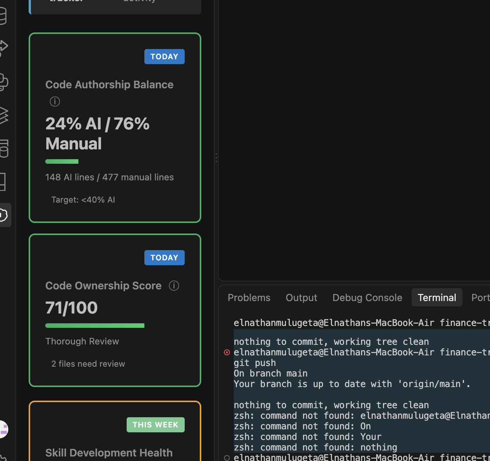

# Student Finance Tracker

**Theme:** Student Finance Tracker
**Live site:** https://etenna-maker.github.io/finance-tracker/
**Repo:** https://github.com/etenna-maker/finance-tracker

A vanilla HTML/CSS/JS app for students to record spending, search it with regex, and see simple totals. No frameworks.

## Setup
1. Clone the repo.
2. Open the folder in VS Code and click **Go Live** (Live Server), or open the GitHub Pages link above.
   (ES modules need a server — double-clicking index.html will not work.)

## Features
- Add transactions (description, amount, category, date) with inline regex validation
- Records table, shown as cards on small screens
- Live regex search with `<mark>` highlighting and safe compile (try/catch)
- Sort by newest or highest amount
- Dashboard: total records, total spent
- Data saved automatically to localStorage
- Mobile-first layout with 3 breakpoints (360px, 768px, 1024px)

## Regex catalog
| Field | Pattern | Valid example | Invalid example |
|---|---|---|---|
| Description | `^\S(?:.*\S)?$` | `Bus to campus` | ` Bus` (leading space) |
| Amount | `^(0\|[1-9]\d*)(\.\d{1,2})?$` | `2000`, `12.50` | `012`, `1.234` |
| Date | `^\d{4}-(0[1-9]\|1[0-2])-(0[1-9]\|[12]\d\|3[01])$` | `2026-10-18` | `2026-13-01` |
| Category | `^[A-Za-z]+(?:[ -][A-Za-z]+)*$` | `Transport` | `Food2` |
| Duplicate word (advanced, back-reference) | `\b(\w+)\s+\1\b` | — | `the the bus` |

Search examples: `bus`, `^moto`, `(coffee|tea)`. An invalid pattern such as `[` shows "Invalid regex" instead of crashing.

## Keyboard map
| Key | Action |
|---|---|
| Tab / Shift+Tab | Move between links, inputs and buttons |
| Enter (on skip link) | Jump to main content |
| Enter (in form) | Save transaction |
| Enter / Space (on Delete) | Delete a row |

Watch the demo on Loom: https://www.loom.com/share/9eaf2d3e64a54f24a09d33b30c96c410

## Accessibility notes
- Landmarks: header, nav, main, sections, footer; one h1, h2 per section
- Skip-to-content link is the first focusable element
- Every input has a `<label for>`; errors linked with `aria-describedby`
- Visible focus outline on links, inputs, select and buttons
- Status messages use `role="status"` / `aria-live`
- Error text colour chosen for contrast on white

## Testing
Manual tests:
1. Add a valid transaction → it appears in the table and totals update.
2. Reload the page → data is still there (localStorage).
3. Enter ` Bus`, `012`, `Food2`, `the the bus` → inline errors appear.
4. Search `[` → "Invalid regex" message, no crash.
5. Resize to 360px, 768px, 1024px → layout changes.

## Known limitations
Not completed due to time: JSON import/export, currency settings, 7-day chart, inline edit, tests.html, seed.json, .

### CodePause dashboard (AI score)

## AI usage disclosure
An AI tutor taught me the concepts. Due to time pressure it also gave me HTML/CSS/JS code, which I typed myself and reviewed line by line; I can explain every file. The spec (docs/spec.md) is my own writing. This README was written with AI help, which the brief allows.
CodeVibe clashed with the older CodePause extension on my machine and lost the assignment record; on my teacher's advice I used CodePause and a dashboard screenshot. Git history shows my timeline.
